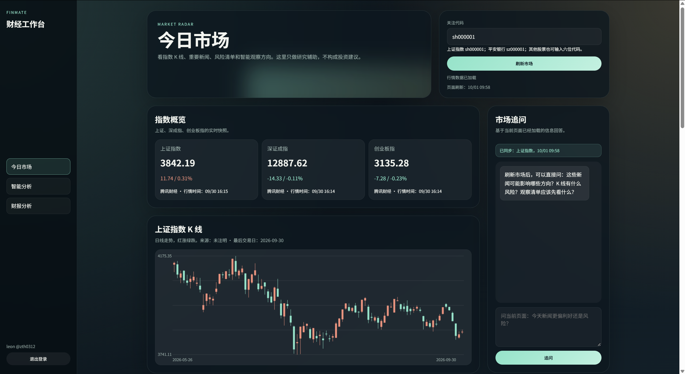
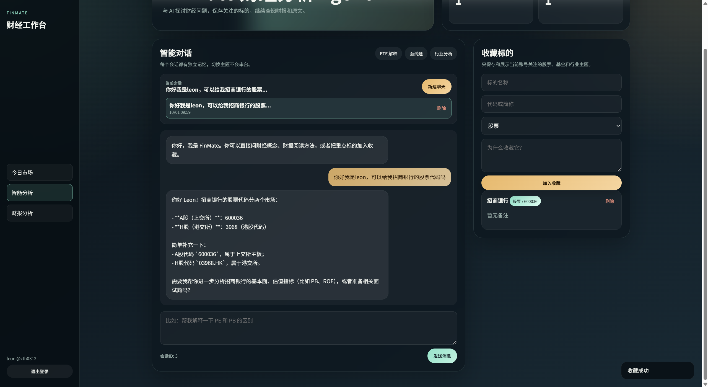
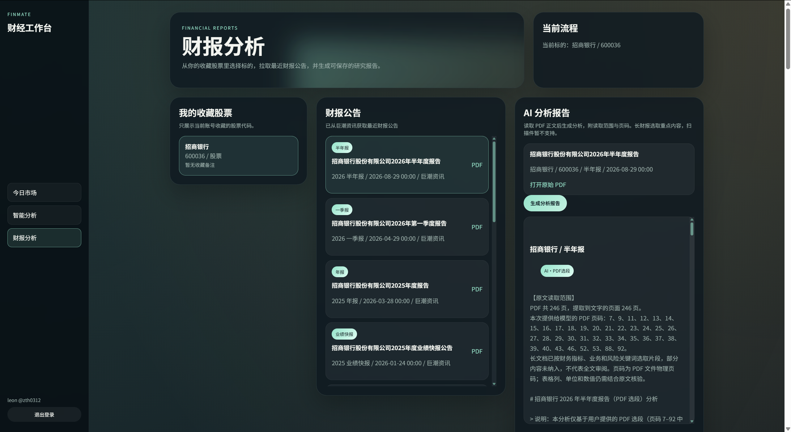
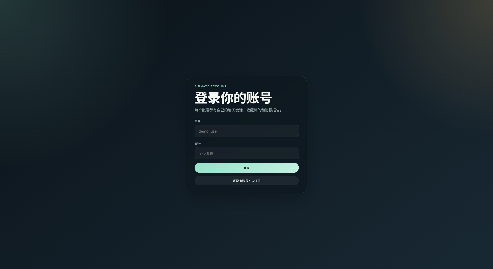
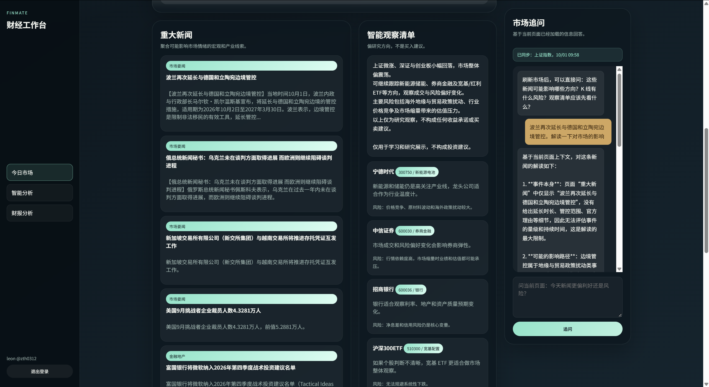
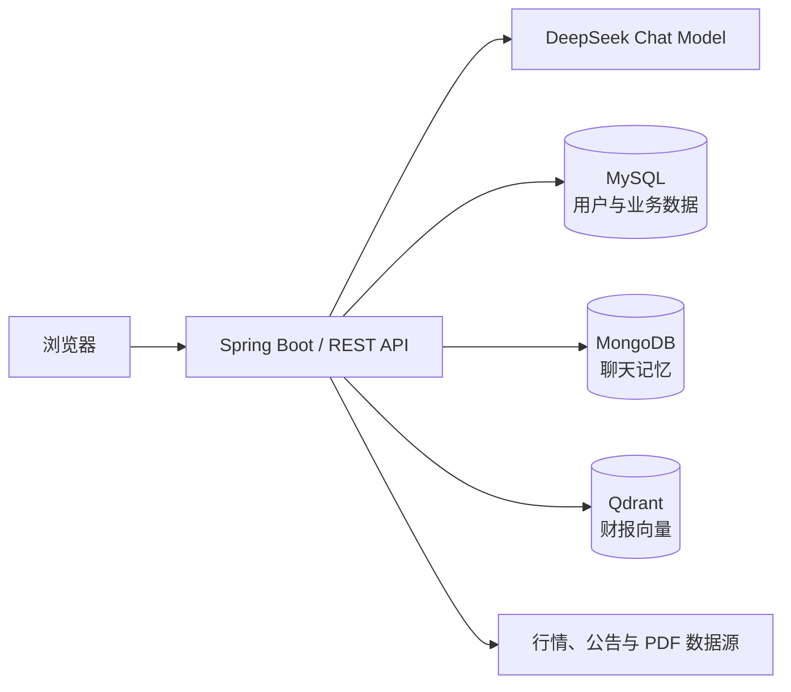

# FinMate — AI 财经分析助手


FinMate 是一个基于 Spring Boot 与 LangChain4j 的财经学习和分析项目。它将 AI 对话、市场概览、股票收藏、财报 PDF 分析和基于原文的 RAG 问答整合在一个 Web 应用中，并通过 MySQL、MongoDB 与 Qdrant 分别管理业务数据、聊天记忆和向量索引。

> 本项目用于技术学习与作品展示，不构成投资建议。市场页面包含外部接口失败时的降级内容，不能作为实时交易依据。

## 界面预览

### 市场总览与页面追问

集中展示主要指数、K 线走势和行情时间；右侧助手只基于当前页面已加载的市场上下文回答。



### AI 对话与收藏标的

支持用户隔离的多会话记忆、财经概念问答和标的收藏，收藏结果会继续用于财报查询与分析。



### 财报公告与 AI 分析

从当前账号的收藏股票中选择标的，读取巨潮资讯财报公告与 PDF 正文，生成附带读取范围和原文页码的分析报告。



<details>
<summary><strong>查看更多界面</strong></summary>

#### 账号登录

账号数据按用户隔离，登录后可继续使用自己的会话、收藏和财报报告。



#### 市场资讯与智能解读

聚合重要新闻、研究观察清单和风险提示，并允许用户针对当前页面内容继续追问。



</details>

## 主要功能

- **财经 AI 对话**：基于 DeepSeek 兼容接口与 LangChain4j，支持多会话及工具调用。
- **账号与数据隔离**：注册、登录、Session 身份校验以及按用户隔离的收藏、会话和财报报告。
- **市场概览**：展示指数、K 线、新闻和观察清单，并支持结合当前页面内容继续追问。
- **自选标的管理**：添加、查询和删除收藏股票，为财报分析提供用户范围约束。
- **财报 PDF 分析**：查询公告、下载 PDF、提取带页码正文、调用模型生成分析并保存历史。
- **财报 RAG 问答**：对完整可提取正文分块、生成向量并写入 Qdrant，回答时返回真实检索片段和页码来源。
- **一键容器化启动**：通过 Docker Compose 同时启动应用、MySQL、MongoDB 和 Qdrant。

## 系统架构



| 层次 | 技术与职责 |
| --- | --- |
| 前端 | 原生 HTML、CSS、JavaScript |
| Web/API | Spring Boot、Spring MVC、Bean Validation、Knife4j |
| AI | LangChain4j、DeepSeek 兼容接口、工具调用、消息窗口 |
| 业务数据 | Spring Data JPA、MySQL |
| 聊天记忆 | Spring Data MongoDB、MongoDB |
| RAG | PDFBox、Embedding API、Qdrant REST API |
| 工程化 | Maven、JUnit 5、Node Test Runner、Docker Compose |

## 快速启动

### 1. 准备环境

只需要安装并启动 Docker Desktop。使用 AI 功能还需要自己的 DeepSeek API Key；启用财报 RAG 时，需要额外准备兼容的 Embedding API Key。

### 2. 创建本地配置

Windows PowerShell：

```powershell
Copy-Item .env.example .env
notepad .env
```

macOS / Linux：

```bash
cp .env.example .env
```

至少修改数据库示例密码；需要 AI 对话时填写 DeepSeek Key：

```dotenv
DEEPSEEK_API_KEY=your_deepseek_api_key
MYSQL_PASSWORD=your_local_mysql_password
MYSQL_ROOT_PASSWORD=your_local_mysql_root_password
```

`.env` 已被 Git 和 Docker 构建上下文忽略，不要强制提交、截图或公开其中的密钥。

### 3. 启动全部服务

```powershell
docker compose up --build -d --wait
```

启动完成后访问：

- 应用首页：<http://localhost:8080>
- API 文档：<http://localhost:8080/doc.html>

查看状态和日志：

```powershell
docker compose ps
docker compose logs -f app
```

修改 `.env` 后，应重新创建应用容器以加载新环境变量：

```powershell
docker compose up -d --force-recreate app
```

停止服务：

```powershell
docker compose down
```

> `docker compose down` 不会删除数据库数据；`docker compose down -v` 会永久删除本项目的 MySQL、MongoDB 和 Qdrant 数据卷。

## 配置说明

常用变量均列在 [.env.example](.env.example) 中。

| 环境变量 | 是否必需 | 默认值/说明 |
| --- | --- | --- |
| `DEEPSEEK_API_KEY` | 使用 AI 时必需 | DeepSeek API Key |
| `DEEPSEEK_BASE_URL` | 否 | `https://api.deepseek.com` |
| `DEEPSEEK_MODEL` | 否 | `deepseek-chat` |
| `MYSQL_DATABASE` | 否 | `finance_agent_db` |
| `MYSQL_USERNAME` | 否 | `finmate` |
| `MYSQL_PASSWORD` | Docker 启动必需 | MySQL 业务用户密码 |
| `MYSQL_ROOT_PASSWORD` | Docker 启动必需 | MySQL root 密码 |
| `MONGODB_DATABASE` | 否 | `chat_memory_db` |
| `FINMATE_PORT` | 否 | 宿主机访问端口，默认 `8080` |
| `FINMATE_RAG_ENABLED` | 否 | 默认 `false` |
| `FINMATE_RAG_EMBEDDING_API_KEY` | 启用 RAG 时必需 | Embedding 服务密钥 |

完整 RAG 参数、索引流程与限制见 [RAG-SETUP.md](RAG-SETUP.md)。

## 关键业务流程

### AI 对话

```text
浏览器提交问题
  → 校验登录用户与会话归属
  → LangChain4j 组装模型、记忆与财经工具
  → 调用模型并按会话保存消息窗口
  → 返回回答
```

### 财报分析与 RAG

```text
选择收藏股票与财报
  → 校验公告来源并下载 PDF
  → PDFBox 提取带页码正文
  ├→ 选段后调用模型生成分析报告
  └→ 全文分块、Embedding、写入 Qdrant
       → 限定当前用户与财报检索
       → 生成带来源片段和页码的回答
```

## 技术实现亮点

- 使用 MySQL、MongoDB、Qdrant 分别承担结构化业务数据、聊天窗口和向量检索，职责清晰。
- 服务层统一执行登录校验和资源归属检查，避免跨用户读取收藏、会话或财报索引。
- 密码采用随机盐与 PBKDF2 散列保存，接口响应不返回密码散列。
- 财报下载前校验来源与协议；RAG 查询按文档代次和用户范围过滤。
- RAG 返回真实检索片段和 PDF 页码，未检索到内容时不调用生成模型。
- 外部行情、公告或模型调用失败时提供明确错误或受控降级，避免把模板内容伪装成真实结果。
- Docker Compose 使用健康检查控制启动顺序，数据库数据通过命名卷持久化。

## 项目结构

```text
src/main/java/com/zth/java/ai/langchain4j/
├── assistant/   # LangChain4j AI Service
├── config/      # 模型、异常处理与兼容配置
├── controller/  # REST 接口
├── dto/         # 请求与响应对象
├── entity/      # MySQL 实体
├── rag/         # 财报分块、索引、检索与问答
├── repository/  # Spring Data 仓储
├── service/     # 业务流程与用户隔离
├── store/       # MongoDB 聊天记忆
└── tools/       # 模型可调用的财经工具
```

更详细的代码阅读顺序见 [LEARNING.md](LEARNING.md)。

## 本地开发与测试

不使用 Docker 直接运行时，需要 Java 17、Maven、MySQL 和 MongoDB，并在当前终端或 IDE Run Configuration 中提供对应环境变量：

```powershell
mvn spring-boot:run
```

执行测试：

```powershell
mvn test
node --check src/main/resources/static/app.js
node --test src/test/js/market-ui.test.cjs src/test/js/report-rag-ui.test.cjs
```

当前自动化测试包含 34 个 Java 测试（其中 1 个需显式开启的真实行情冒烟测试默认跳过）与 6 个前端交互测试，包括用户隔离、财报分块、引用范围、失败重试、向量维度校验、行情源降级和前端索引复用。默认测试使用模拟依赖，不调用真实付费模型，也不能替代外部服务的端到端联调。

## 数据与已知限制

- Docker 数据保存在当前电脑的命名卷中，不会随 Git 仓库迁移到另一台电脑。
- PDF 仅处理可提取文字，不支持扫描件 OCR；复杂表格可能丢失列关系。
- 当前 RAG 聚焦单份财报问答，尚未实现跨文档检索、混合检索、重排序和后台任务队列。
- 财报索引为单机同步任务，不适合作为高并发生产实现。
- 行情支持腾讯与东方财富数据源切换；无真实数据时显示不可用，不生成示例 K 线。指数展示数据来源和行情时间；K 线展示来源和最后交易日。
- 本项目是学习与作品展示项目，不提供生产环境安全、监控和高可用保证。
